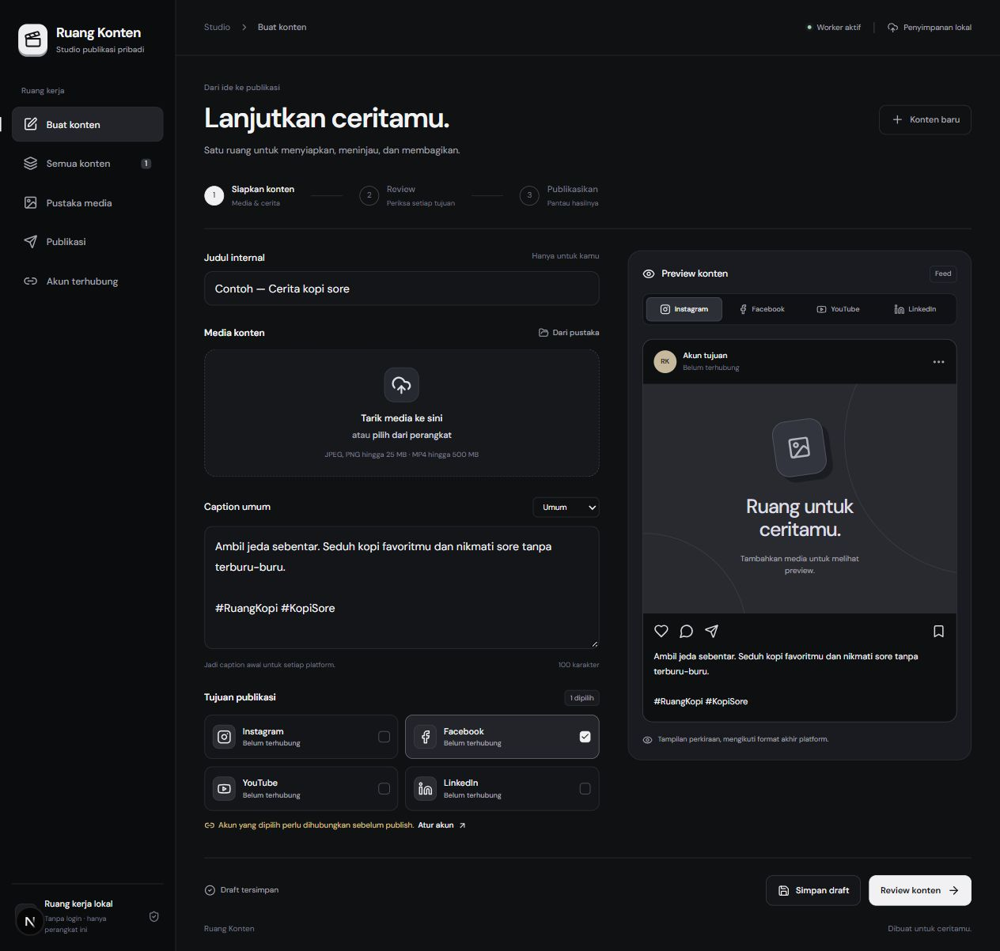

# Ruang Konten

Studio publikasi pribadi untuk Instagram, Facebook Page, YouTube, dan LinkedIn. Antarmuka gelap mengikuti konsep yang disetujui. Aplikasi berjalan lokal tanpa login.



## Menjalankan

Memerlukan Node.js 22.12 atau lebih baru. Implementasi ini diuji menggunakan Node.js 22.22 pada Windows.

```powershell
npm install
npm run dev
```

Buka [http://127.0.0.1:3000](http://127.0.0.1:3000). Perintah dev menyiapkan PostgreSQL persisten di `.data/postgres`, menyinkronkan skema, dan menjalankan web serta worker. Startup pertama memerlukan waktu untuk inisialisasi database dan kompilasi.

Jika sudah memiliki PostgreSQL, isi `DATABASE_URL` pada `.env.local`; dev akan menggunakan database tersebut. Database tujuan harus dikhususkan untuk aplikasi ini. `prisma db push` menyinkronkan skema pengembangan dan tidak memakai flag penghapusan data.

## Menjalankan di VPS lewat domain HTTPS

Jalankan PostgreSQL, web (`npm run start -- --port 3005`), dan satu worker (`npm run worker`) di VPS. Siapkan `DATABASE_URL` dan build aplikasi terlebih dahulu. Web tetap mendengarkan di `127.0.0.1`.

Di `.env.local`, isi `APP_ORIGIN=https://content.example.com` dan `RUANG_PROXY_SECRET` dengan hasil `openssl rand -hex 32`. Ganti contoh domain dengan domain Anda. Untuk Instagram, daftarkan `https://content.example.com/api/accounts/instagram/callback` di Meta dan isi `INSTAGRAM_REDIRECT_URI` dengan URL yang sama.

Lindungi seluruh domain dengan autentikasi di reverse proxy. Proxy harus meneruskan `Host` asli dan menimpa header `X-Ruang-Proxy-Secret` dengan secret yang sama. Contoh Caddyfile setelah membuat hash dengan `caddy hash-password`:

```caddyfile
content.example.com {
    basic_auth {
        admin GANTI_DENGAN_HASH_PASSWORD
    }
    reverse_proxy 127.0.0.1:3005 {
        header_up X-Ruang-Proxy-Secret GANTI_DENGAN_RUANG_PROXY_SECRET
        header_up -Authorization
    }
}
```

Simpan secret di konfigurasi proxy pada server. Setelah memperbarui kode dan `.env.local`, jalankan `npm run build`, restart proses web dan worker, lalu muat ulang konfigurasi proxy. Untuk OAuth, jalankan satu proses web karena sesi sementara disimpan dalam memori proses tersebut.

## Alur penggunaan

1. Buka **Akun terhubung**. Pilih **Hubungkan dengan Instagram** untuk masuk dan memberi izin di Instagram. Untuk Facebook atau koneksi Instagram manual, tempel token lalu klik **Deteksi akun**, pilih tujuan, dan klik **Simpan akun**.
2. Untuk YouTube, isi Client ID dan Client Secret pada **Akun terhubung**, lalu klik **Hubungkan dengan Google** dan pilih kanal. Untuk LinkedIn, isi nama, identitas tujuan, dan token lalu jalankan **Cek koneksi**.
3. Buka **Buat konten**; isi judul internal, unggah media, dan tulis caption.
4. Pilih tujuan. Gunakan pilihan caption untuk mengubah teks khusus platform tanpa menimpa caption umum.
5. Lengkapi metadata bila memilih YouTube, lalu pilih **Review konten**.
6. Periksa akun, teks, media, visibilitas, dan peringatan. Klik **Publikasikan ke N tujuan** untuk membuat antrean nyata.
7. Pantau **Publikasi**. Tujuan yang gagal jelas dapat dicoba ulang. Status **Perlu dicek** tidak dicoba ulang otomatis karena platform mungkin sudah menerima posting.

Upload, simpan draft, dan cek koneksi tidak membuat posting. Pengujian otomatis tidak memublikasikan ke media sosial.

## Media dan penyimpanan cloud

Gambar JPEG/PNG maksimum 25 MB, video MP4 maksimum 500 MB. Backend memeriksa signature file, ukuran, dimensi, dan metadata video. Dukungan format akhir tetap mengikuti aturan platform.

Secara default file disimpan di `.data/media`; preview, draft, serta upload langsung Facebook/YouTube/LinkedIn dapat memakai file lokal. Instagram memerlukan URL media yang dapat diambil Meta; konfigurasikan Cloudinary atau R2 sebelum mengaktifkan tujuan tersebut.

Untuk Cloudinary, isi tiga nilai berikut pada `.env.local` dari **Cloudinary Console → Settings → API Keys**, kemudian mulai ulang web dan worker (`npm run dev` menjalankan keduanya):

```dotenv
CLOUDINARY_CLOUD_NAME=
CLOUDINARY_API_KEY=
CLOUDINARY_API_SECRET=
```

Saat pengguna mengonfirmasi publish ke Instagram, worker mengunggah file lokal ke Cloudinary, menunggu upload lengkap, memeriksa `secure_url`, lalu meneruskan URL tersebut ke Instagram. Review dan simpan draft tidak mengunggah ke Cloudinary. Upload video besar dibagi menjadi potongan 20 MiB. Batas ukuran akun Cloudinary tetap berlaku. API secret hanya berada di backend; upload preset unsigned tidak diperlukan.

Media memakai delivery publik Cloudinary agar Instagram dapat mengambilnya. File cloud tetap tersimpan setelah publikasi dan tidak dihapus otomatis ketika media lokal dihapus. Upload ulang media yang sama memakai public ID `ruang-konten/<media-id>` yang sama. Implementasi ini menggunakan hostname CDN standar `res.cloudinary.com`; custom delivery hostname belum didukung.

Rasio gambar Instagram tidak menghasilkan error atau peringatan lokal. File diteruskan dalam ukuran aslinya; keputusan penerimaan media mengikuti respons Instagram saat publishing. Aplikasi tidak memotong gambar otomatis.

Sebagai alternatif, salin pengaturan R2 dari `.env.example` ke `.env.local`, lalu isi `R2_ENDPOINT`, `R2_ACCESS_KEY_ID`, `R2_SECRET_ACCESS_KEY`, dan `R2_BUCKET`. Bucket tetap privat. Worker menyalin media yang diperlukan ke R2 saat publikasi Instagram dan membuat URL baca sementara selama satu jam. Jika Cloudinary dan R2 lengkap, Cloudinary diprioritaskan. Kegagalan Cloudinary menghentikan publikasi tujuan Instagram; aplikasi tidak beralih provider diam-diam.

Token platform dimasukkan melalui halaman akun, bukan berkas frontend. Token disimpan dengan AES-256-GCM; kuncinya di `.data/secret.key`. Cadangkan kunci bersama database secara privat agar kredensial dapat dipulihkan. Jangan hapus atau commit `.data`, `.env.local`, atau hasil ekspor database.

## Koneksi platform

| Platform | Identitas dan token |
| --- | --- |
| Instagram | Login resmi Instagram untuk akun Business/Creator. Koneksi manual menerima token Instagram atau token Facebook dengan akses ke Page yang terhubung. |
| Facebook | Page access token atau user token dengan akses Page; pilih Page hasil deteksi. Profil pribadi tidak didukung |
| YouTube | Client ID dan Client Secret dari OAuth Client Google tipe Web application. Kanal dideteksi setelah pemberian izin. Koneksi access token manual juga tersedia. |
| LinkedIn | Login OAuth dengan Client ID dan Client Secret untuk profil anggota; token manual juga didukung. |

Cek koneksi memeriksa identitas akun. Platform memeriksa izin publishing saat operasi sesungguhnya. Versi API dapat dikonfigurasi melalui `META_API_VERSION` dan `LINKEDIN_API_VERSION`. Untuk koneksi berbasis access token manual, perbarui token kedaluwarsa di halaman akun.

Deteksi akun tidak menyimpan perubahan sampai **Simpan akun** ditekan. Backend memeriksa kembali pilihan sebelum menyimpan token yang sesuai secara terenkripsi. Untuk token Facebook milik pengguna, izin `pages_show_list` diperlukan agar daftar Page dapat dibaca; izin baca Page/Instagram yang sesuai tetap diperlukan. Token turunan Page tidak dikirim ke browser.

### Instagram melalui Unified Login

1. Di Meta for Developers, buka **Instagram → API setup with Unified login → Create new configuration**. Pilih **General**, token **System-user access token (SUAT)**, dan masa berlaku **Never**. Pilih akun Instagram sebagai business asset. Untuk kebutuhan aplikasi ini, cukup izinkan `instagram_basic` dan `instagram_content_publish`.
2. Host [instagram-callback.html](docs/assets/instagram-callback.html) pada situs HTTPS yang Anda kelola. Pastikan URL file bisa dibuka, lalu tambahkan URL tersebut di **Register a new redirect URL** dan pilih dari daftar. Halaman ini meneruskan hasil login ke Ruang Konten pada `http://127.0.0.1:3000`. Gunakan hosting callback yang tidak mencatat query string.
3. Salin **Configuration ID** dari konfigurasi yang dibuat. Dari **App settings → Basic**, salin **App ID** dan **App Secret**. Tambahkan ke `.env.local` bersama callback:

   ```dotenv
   META_APP_ID=...
   META_APP_SECRET=...
   INSTAGRAM_CONFIG_ID=...
   INSTAGRAM_REDIRECT_URI=https://domain-anda.example/instagram-callback.html
   ```

4. Samakan `INSTAGRAM_REDIRECT_URI` dengan URL yang diterima Meta. Mulai ulang `npm run dev`, buka Ruang Konten di `http://127.0.0.1:3000`, lalu klik **Akun terhubung → Hubungkan dengan Instagram**. Aplikasi membuat `state` untuk sesi browser dan menyimpan token terenkripsi setelah akun terhubung.

Unified Login memakai Meta Graph API dan Configuration ID. Beri akses ke satu akun Instagram saja pada konfigurasi ini; aplikasi saat ini menghubungkan satu akun Instagram per konfigurasi. Simpan App Secret hanya di `.env.local`. [Instagram API resmi Meta](https://developers.facebook.com/docs/instagram-platform/)

### YouTube melalui Google OAuth

1. Aktifkan **YouTube Data API v3** di proyek Google Cloud. Buka OAuth Client tipe **Web application** di Google Auth Platform.
2. Tambahkan **Redirect URI untuk Google Cloud** yang ditampilkan pada kartu YouTube ke **Authorized redirect URIs**. Pada alamat bawaan, nilainya `http://127.0.0.1:3000/api/accounts/youtube/callback`. Host dan port harus sama persis dengan alamat yang digunakan. Client dari n8n dapat dipakai kembali dengan menambahkan URI ini ke daftar yang sama.
3. Isi Client ID dan Client Secret di aplikasi, klik **Hubungkan dengan Google**, lalu pilih kanal dan setujui akses baca serta upload. Jika OAuth berstatus **Testing**, tambahkan akun Google tersebut ke **Test users**.

Backend menyimpan Client Secret dan refresh token secara terenkripsi. Saat mengecek koneksi atau sebelum upload, backend mengambil access token baru dan mencocokkan kanal dengan tujuan tersimpan. Hubungkan ulang bila Google mencabut atau mengakhiri grant. Google dapat membatasi masa berlaku refresh token untuk proyek eksternal berstatus Testing. [Panduan OAuth Google](https://developers.google.com/identity/protocols/oauth2/web-server) · [Masa berlaku token](https://developers.google.com/identity/protocols/oauth2#expiration)

### LinkedIn melalui OAuth

1. Di LinkedIn Developer Portal, aktifkan produk **Sign In with LinkedIn using OpenID Connect** dan **Share on LinkedIn** pada aplikasi. OIDC dipakai untuk membaca profil; `w_member_social` diperlukan untuk menerbitkan posting sebagai profil anggota.
2. Salin **Authorized redirect URL LinkedIn** yang ditampilkan di kartu LinkedIn ke bagian **Auth → Authorized redirect URLs**. Alamat bawaan adalah `http://127.0.0.1:3000/api/accounts/linkedin/callback`; host dan port harus sama dengan yang dipakai saat membuka Ruang Konten.
3. Isi **Client ID** dan **Primary Client Secret** di kartu LinkedIn, lalu klik **Hubungkan dengan LinkedIn** dan setujui izin.

Access token LinkedIn disimpan terenkripsi. Jika LinkedIn mengakhiri masa berlaku atau mencabut token, klik **Hubungkan ulang**. OAuth ini menghubungkan profil anggota; posting ke organisasi tetap memerlukan izin Community Management API dan akses organisasi yang sesuai. [OAuth 3-legged LinkedIn](https://learn.microsoft.com/en-us/linkedin/shared/authentication/authorization-code-flow) · [Sign In with LinkedIn OIDC](https://learn.microsoft.com/en-us/linkedin/consumer/integrations/self-serve/sign-in-with-linkedin-v2) · [Share on LinkedIn](https://learn.microsoft.com/linkedin/consumer/integrations/self-serve/share-on-linkedin)

## Stack dan struktur

- Next.js 16, React 19, TypeScript, dan CSS dengan token desain; tidak ada framework backend tambahan.
- PostgreSQL + Prisma untuk data aplikasi dan transaksi review/publish.
- pg-boss untuk antrean persisten; worker Node.js terpisah dengan satu worker aktif per database.
- Penyimpanan lokal untuk development, Cloudinary atau R2 untuk pengambilan media oleh Instagram.
- Sharp, file-type, dan FFprobe untuk pemeriksaan media. Antarmuka memakai Lucide.

`src/components` memiliki editor, preview, akun, dan riwayat. `src/lib/domain.ts` memiliki kontrak bersama dan validasi konten. `src/server` memiliki API, penyimpanan, enkripsi, dan adapter platform. `src/worker.ts` memiliki lifecycle pekerjaan. Skema berada di `prisma/schema.prisma`.

SDK R2 dimuat hanya ketika diperlukan, sehingga halaman draft dan API status tidak menunggu pemuatan storage cloud. Data runtime dan berkas lingkungan dikecualikan dari tracing build.

Adapter Cloudinary menggunakan REST Upload API dari backend tanpa SDK tambahan, mengikuti [autentikasi resmi](https://cloudinary.com/documentation/authentication_signatures) dan [upload bertahap resmi](https://cloudinary.com/documentation/upload_images#manual_chunked_upload_rest).

## Verifikasi

```powershell
npm test
npm run typecheck
npm run test:integration
npm run test:smoke
npm run build
```

`test:integration` memerlukan PostgreSQL aktif dengan izin membuat database. Pengujian membuat database sementara sendiri, memakai respons provider yang dimock, lalu menghapus database tersebut. Worker aplikasi tidak terhubung ke database uji.

`test:smoke` memerlukan web berjalan pada `APP_ORIGIN` atau `http://127.0.0.1:3000`. Pengujian membuat media/draft sementara dan membersihkannya; tidak memanggil API publishing.

Untuk build saat dev aktif, tetapkan `NEXT_DIST_DIR=.next-build` agar output build tidak bertabrakan dengan `.next`. Jalankan production web dengan nilai yang sama. `npm start` hanya menjalankan web; PostgreSQL dan `npm run worker` harus tetap berjalan terpisah. Untuk pemakaian lokal awal, gunakan `npm run dev`.

## Batas implementasi awal

- Adapter keempat platform sudah ditulis, tetapi publikasi langsung dengan token pemilik belum diuji. Tidak ada klaim bahwa semua permission/format sudah terverifikasi.
- Penjadwalan, carousel, multiakun, refresh token untuk platform selain YouTube OAuth, pengeditan posting eksternal, serta analytics belum tersedia.
- Hasil timeout ambigu memerlukan pemeriksaan manual. Aplikasi menampilkan ID provider bila tersedia; rekonsiliasi otomatis lintas provider belum tersedia.
- Pembersihan otomatis media yatim tujuh hari dan backup otomatis dari PRD belum diimplementasikan. File yang masih dirujuk draft/riwayat dilindungi dari penghapusan manual.
- Daftar awal dibatasi 100 draft/media dan 50 batch terbaru; pagination lanjutan belum tersedia.
- Tanpa login, web dan database harus tetap dibatasi ke localhost. Hosting publik memerlukan kontrol akses tambahan.

Lihat [PRD](docs/PRD.md) untuk rencana produk dan [catatan implementasi](docs/implementation-timeline/publishing/2026-11-11-tambah-studio-publikasi-lokal.md) untuk hasil serta batas verifikasi.
