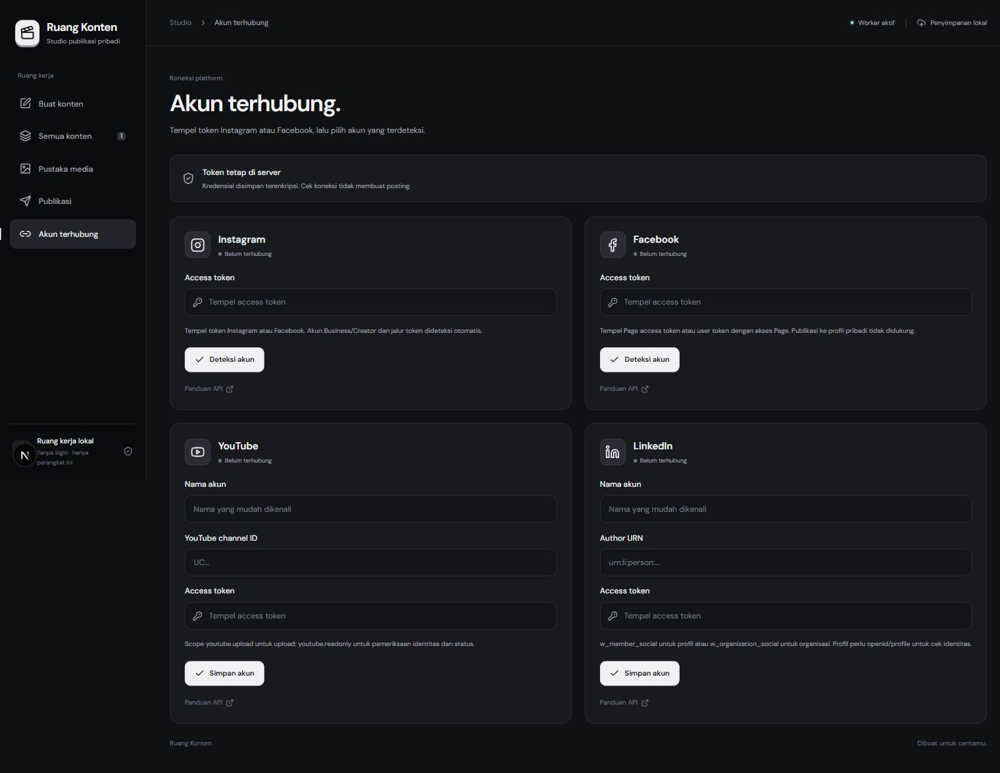

# Sederhanakan koneksi Instagram dan Facebook

> Tanggal: 2026-11-11, Asia/Jakarta  
> Status: verified — alur lokal dan respons provider yang dimock; token pemilik belum diuji  
> Jenis: feature  
> Lingkup: koneksi akun Meta di UI dan backend

## Hasil

Instagram dan Facebook sekarang memakai alur **tempel token → deteksi akun → periksa/pilih nama tujuan → simpan**. Pengguna tidak mengisi ID, nama, atau jalur login manual. Satu hasil dipilih otomatis untuk ditinjau; beberapa hasil memerlukan pilihan eksplisit. YouTube dan LinkedIn tetap memakai konfigurasi sebelumnya.

## Mekanisme

[Resolver Meta](../../../src/server/meta-accounts.ts) membaca identitas Instagram Login atau mendeteksi Facebook Page/token pengguna beserta akun Instagram yang terhubung. Pagination mengikuti cursor melalui URL yang dibangun server, dibatasi lima halaman, dan menolak daftar yang belum lengkap. Timeout, rate limit, serta kegagalan server menghentikan probe.

[API akun](../../../src/server/api.ts) menyediakan `POST /api/accounts/{instagram|facebook}/discover` dan `/connect`. Deteksi hanya mengembalikan identitas publik dan tidak menulis database. Saat koneksi disimpan, backend mendeteksi ulang dan memvalidasi ID pilihan terhadap hasil provider. Token Page hasil turunan hanya berada di server dan disimpan dengan enkripsi yang sudah ada. Pemeriksaan pekerjaan aktif tetap berlaku. Tidak ada perubahan skema.

[Form akun](../../../src/components/accounts.tsx) menyamarkan token, membersihkan hasil deteksi saat token berubah, dan menampilkan pemilihan berdasarkan nama. Identitas dari token ditandai terverifikasi setelah disimpan; izin publishing tetap diperiksa oleh platform ketika publish.

## Verifikasi

- `npm test`: 36 pengujian lolos, termasuk Instagram Login, token Page langsung, daftar beberapa Page, Instagram tertaut, cursor, hasil kosong, dan rate limit.
- `npm run typecheck` dan `npm run build`: lolos; build memakai `NEXT_DIST_DIR=.next-build` agar tidak mengganggu dev server.
- `npm run test:integration`: lolos pada database PostgreSQL sementara. Membuktikan deteksi tidak menyimpan, pilihan palsu ditolak, token turunan disimpan terenkripsi tanpa bocor dalam respons, deteksi gagal mempertahankan koneksi lama, dan pekerjaan aktif memblokir penggantian akun.
- Browser lokal: form Meta hanya memiliki satu input password; tampilan desktop serta viewport 375 × 812 diperiksa, tanpa overflow horizontal pada layar sempit.

## Batas dan sumber kontrak

Tidak menggunakan kredensial pemilik dan tidak melakukan publikasi nyata. Token harus memiliki izin yang sesuai; aplikasi tidak menambah permission atau melakukan OAuth secara otomatis. Daftar dibatasi sampai 500 Page per deteksi. Aplikasi tetap menyimpan satu akun per platform.

Kontrak penemuan Page/token mengikuti [koleksi resmi Meta](https://www.postman.com/meta/instagram/documentation/6yqw8pt/instagram-api); jalur Instagram Login mengikuti [dokumentasi Instagram Platform](https://developers.facebook.com/docs/instagram-platform/instagram-api-with-instagram-login/get-started). Periksa ulang kontrak saat versi API berubah. Panduan pemakaian aktif berada di [README aplikasi](../../../README.md).

Folder ini belum merupakan repositori Git; catatan hanya mengatribusikan perubahan alur koneksi Meta pada tugas ini, bukan seluruh implementasi studio sebelumnya.
